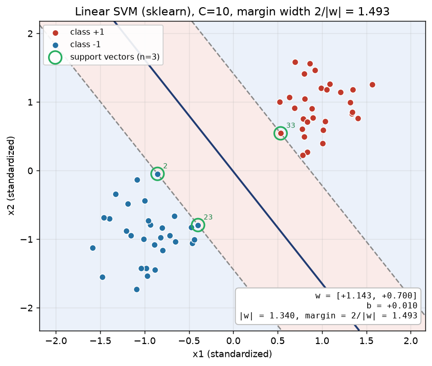

# 第 6 周 · 基础档｜线性 SVM：从间隔最大化的原始问题到对偶问题

> **原文任务**：推导/讲解 SVM 间隔最大化原始问题到对偶问题的拉格朗日转换；实现：用 sklearn 实现线性 SVM 并可视化支持向量。
> **对应教材**：第 6 章 式 6.1–6.24　**配套代码**：[第6周_基础档.py](第6周_基础档.py)
> **讲演配额**：15 分钟讲 + 5 分钟答辩；推导板书，实现现场运行。

---

## 一、15 分钟怎么排

| 时间 | 内容 | 形式 |
|---|---|---|
| 0–2 min | 问题背景：为什么“间隔最大”是好的 | 口述 + 一页 PPT |
| 2–8 min | 板书：几何间隔 → 原始问题 → 拉格朗日 → 对偶 → KKT | 板书，逐步编号 |
| 8–12 min | 现场跑 `第6周_基础档.py`，讲 `dual_coef_` 的稀疏性 | 终端投屏 |
| 12–14 min | 读结果：w、b、间隔宽度、支持向量 | 图 + 数字 |
| 14–15 min | 小结 + 给第 7 周（核函数）留伏笔 | 口述 |

---

## 二、板书推导

### 1. 几何间隔与“令函数间隔为 1”

超平面 $w\cdot x+b=0$，样本点到它的距离是 $\dfrac{|w\cdot x+b|}{\|w\|}$。

- **函数间隔**：$\hat\gamma_i=y_i(w\cdot x_i+b)$
- **几何间隔**：$\gamma_i=\dfrac{y_i(w\cdot x_i+b)}{\|w\|}$

关键观察：$(w,b)\to(tw,tb)$ 不改变超平面，函数间隔随 $t$ 等比放大、几何间隔不变。所以可以自由缩放，**令最近点的函数间隔等于 1**：

$$y_i(w\cdot x_i+b)\ge 1,\quad i=1,\dots,m$$

于是两类到超平面的最近距离各是 $1/\|w\|$，**总间隔**（margin）为

$$\text{margin}=\frac{2}{\|w\|}$$

### 2. 原始问题（式 6.6）

“最大化间隔”等价于“最小化 $\|w\|^2$”：

$$\min_{w,b}\ \frac12\|w\|^2\quad \text{s.t.}\quad y_i(w\cdot x_i+b)\ge 1,\ i=1,\dots,m$$

目标函数是**严格凸二次函数**、约束是**线性**的 ⇒ 凸二次规划，局部最优即全局最优。

### 3. 拉格朗日函数（式 6.8）

引入乘子 $\alpha_i\ge 0$：

$$L(w,b,\alpha)=\frac12\|w\|^2+\sum_{i=1}^{m}\alpha_i\bigl(1-y_i(w\cdot x_i+b)\bigr)$$

对 $w,b$ 求偏导并令零（这一步是全部推导的关键，板书要写全）：

$$\frac{\partial L}{\partial w}=w-\sum_i\alpha_iy_ix_i=0\ \Longrightarrow\ \boxed{w=\sum_i\alpha_iy_ix_i}\tag{6.9}$$

$$\frac{\partial L}{\partial b}=-\sum_i\alpha_iy_i=0\ \Longrightarrow\ \boxed{\sum_i\alpha_iy_i=0}\tag{6.10}$$

### 4. 代回得到对偶问题（式 6.11）

先算二次项：由 (6.9)，$\|w\|^2=w\cdot w=\sum_i\sum_j\alpha_i\alpha_jy_iy_j\,x_i^\top x_j$。再算交叉项：

$$\sum_i\alpha_iy_i(w\cdot x_i+b)=\sum_i\alpha_iy_iw\cdot x_i+b\underbrace{\sum_i\alpha_iy_i}_{=0}=\|w\|^2$$

代回 $L$：

$$L=\frac12\|w\|^2+\sum_i\alpha_i-\|w\|^2=\sum_i\alpha_i-\frac12\sum_i\sum_j\alpha_i\alpha_jy_iy_j\,x_i^\top x_j$$

于是对偶问题为

$$\max_{\alpha}\ \sum_{i}\alpha_i-\frac12\sum_{i}\sum_{j}\alpha_i\alpha_jy_iy_j\,x_i^\top x_j$$
$$\text{s.t.}\quad \sum_i\alpha_iy_i=0,\qquad \alpha_i\ge 0,\ i=1,\dots,m$$

**对偶的三个好处**（答辩必问，记牢）：

1. 变量个数从特征维数 $d$ 变成样本数 $m$（高维小样本时维度灾难被绕开）；
2. 约束变成一个等式 + 非负约束，结构简单，可用 SMO 逐对求解；
3. 目标函数**只出现内积** $x_i^\top x_j$ ⇒ 换成 $K(x_i,x_j)$ 就是核方法（第 7 周）。

### 5. KKT 条件与“支持向量”的由来（式 6.12–6.13）

$$\alpha_i\ge 0,\qquad y_if(x_i)-1\ge 0,\qquad \alpha_i\bigl(y_if(x_i)-1\bigr)=0$$

互补松弛 $\alpha_i(y_if(x_i)-1)=0$ 给出两种情形：

| 情形 | 含义 |
|---|---|
| $\alpha_i=0$ | $y_if(x_i)\ge 1$：点在间隔之外，**对模型无影响** |
| $\alpha_i>0$ | $y_if(x_i)=1$：点**恰好落在间隔边界上**，这就是支持向量 |

所以 $w=\sum\alpha_iy_ix_i$ 只由少数支持向量决定 ⇒ **解的稀疏性**。这也正是代码里 `dual_coef_` 绝大多数分量是 0 的原因。

### 6. 预测函数与 b

由 (6.9)：

$$f(x)=w\cdot x+b=\sum_i\alpha_iy_i\,x_i^\top x+b$$

$b$ 由任一支持向量定出（硬间隔下所有支持向量都满足 $y_if(x_i)=1$；实际取平均更稳；软间隔中必须只用 $0<\alpha_i<C$ 的自由支持向量）：

$$b=y_i-\sum_j\alpha_jy_j\,x_j^\top x_i,\qquad i\in\{k:\alpha_k>0\}$$

---

## 三、配套代码在做什么

> **运行环境**：本机默认 `python3` 未装 scikit-learn / matplotlib，实测使用 `/opt/miniconda3/envs/learn/bin/python`（numpy 2.5.4、scikit-learn 1.9.1、matplotlib 3.11.2）。

```bash
python3 第6周_基础档.py
```

| 步骤 | 代码 | 要点 |
|---|---|---|
| 造数据 | `make_blobs` + `StandardScaler` | 必须先标准化，否则间隔宽度没有几何意义 |
| 训练 | `SVC(kernel="linear", C=10)` | 用 `SVC` 不用 `LinearSVC`（后者是 squared hinge，与推导对不上） |
| 取对偶解 | `clf.dual_coef_`、`clf.support_` | `dual_coef_` 是 $\alpha_iy_i$，不是 $\alpha_i$ |
| 还原 w | `X[sv].T @ dual_coef_` | 就是式 (6.9) |
| 画图 | `contour(levels=[-1,0,1])` | 直接画 `decision_function` 的三条等值线 |
| 自检 | KKT 三条分支数值验证 | 支持向量上 $\lVert yf-1\rVert\approx 0$，非支持向量上 $yf\ge1$ |

关键五行（现场演示时逐行读）：

```python
clf = SVC(kernel="linear", C=10).fit(X, y)
dual = clf.dual_coef_.ravel()        # α_i y_i，只有支持向量非零
alpha = np.abs(dual)                 # y_i = ±1，所以 α_i = |α_i y_i|
w = X[clf.support_].T @ dual         # w = Σ α_i y_i x_i （式 6.9）
b = clf.intercept_[0]
```

---

## 四、本机实测输出

数据：60 个样本（正负各 30），二维、已标准化。

```
支持向量个数  : 3  -> 下标 [2, 23, 33]
对偶系数非零数: 3  (等价于支持向量个数，体现解的稀疏性)

w = Σ α_i y_i x_i = [+1.142509, +0.699835]
b = +0.009606
||w|| = 1.339812   间隔宽度 2/||w|| = 1.492747

sklearn dual_coef_ = [-0.6711 -0.2267  0.8978]

支持向量上 y_i f(x_i) 的最大偏差 |y f - 1| = 4.09e-04  (应≈0)
非支持向量上 min y_i f(x_i) = 1.0588  (应 ≥ 1)
训练集准确率  : 1.0000
```

三个可讲的数字：

1. **60 个样本只有 3 个支持向量**（5%），$w$ 只由这 3 个点决定 —— 稀疏性的直接证据；
2. 60 个 $\alpha_i$ 中 57 个恰好为 0，只有 3 个非零，与 `support_` 完全对应；
3. 间隔宽度 1.49，而全部点都被正确分类且间隔外 —— 说明这组数据近似线性可分。



*图中实线为 $w\cdot x+b=0$，两条虚线为 $\pm1$ 间隔边界，绿圈是支持向量（编号为样本下标）；右下角给出 $w$、$b$ 与间隔宽度。*

---

## 五、答辩预演（教师常问）

| 问题 | 回答要点 |
|---|---|
| 为什么可以令函数间隔为 1？ | 缩放不变性：$(w,b)\to(tw,tb)$ 几何间隔不变、函数间隔等比例放大，总能把最近点缩到 1，不损失任何解 |
| 对偶问题到底换来了什么？ | 三个好处：变量数 $m$ 而非 $d$；约束简单可逐对求解（SMO）；只含内积 → 可核化 |
| 支持向量为什么稀疏？ | 由互补松弛，只有 $y_if(x_i)=1$ 的点 $\alpha_i>0$；其余点 $\alpha_i=0$ 且 $y_if>1$ |
| $b$ 唯一吗？为什么要平均？ | 理论上任一支持向量都能定出同一个 $b$；数值上各点结果有 $10^{-4}$ 级差异，取平均更稳 |
| `dual_coef_` 为什么是 $\alpha_iy_i$？ | libsvm 内部存 $y_i\alpha_i$，取绝对值才得到 $\alpha_i$；符号在还原 $w$ 时自动用上 |
| $C=10$ 还是硬间隔吗？ | 不是，是软间隔；这组数据近似可分，所以解接近硬间隔，但 $\alpha_i\le C$ 的盒约束仍在 |

---

## 六、对照评分标准的自查

- [x] **推导正确性(30)**：式 (6.9)(6.10) 的求导、交叉项消去、对偶目标全部写全，不跳步
- [x] **逻辑清晰度(20)**：几何间隔 → 原始 → 拉格朗日 → 对偶 → KKT，一条线
- [x] **代码实现(20)**：脚本一键跑通，输出可复现（打印了全部关键量）
- [x] **问答应对(20)**：上面 6 问已准备
- [x] **表达与时间(10)**：板书编号 + 15 分钟时间表
