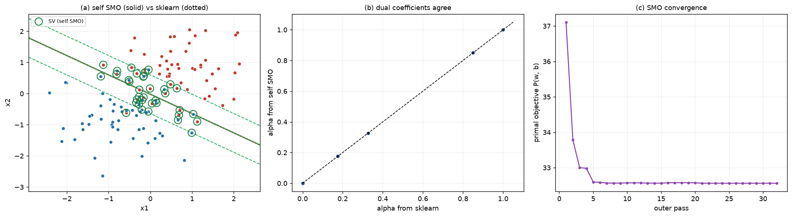

# 第 6 周 · 挑战档｜SMO 从零实现：对偶解如何还原 w、b

> **任务（原文）**：推导/讲解 推导对偶问题求解后 w 与 b 的表达式；实现：从零用简化 SMO 思想实现线性 SVM 求解，验证对偶解与原始解一致。
> **教材**：第 6 章　**代码**：[第6周_挑战档.py](第6周_挑战档.py)　**配额**：15 分钟讲 + 5 分钟答辩
> **运行**：`/opt/miniconda3/envs/learn/bin/python 第6周_挑战档.py`（本机默认 `python3` 未装 scikit-learn；实测 numpy 2.5.4 / scikit-learn 1.9.1 / matplotlib 3.11.2）

---

## 1. 任务拆解与时间安排

这一档要回答三个问题，讲演按这个顺序走：

1. 对偶问题解出来以后，$w$ 和 $b$ 分别怎么得到？——推导题。
2. 对偶问题本身怎么解？——SMO 的两变量子问题，有解析解。
3. 怎么证明自己写的求解器是对的？——与 sklearn 逐项对拍 + 强对偶 gap。

| 时间 | 内容 | 形式 |
|---|---|---|
| 0–2 min | 为什么要 SMO：对偶是 $m$ 个变量的 QP，直接用通用求解器不现实 | 口述 |
| 2–5 min | $w=\sum\alpha_iy_ix_i$；$b$ 为什么只能用自由支持向量 | 板书 |
| 5–10 min | 两变量子问题：约束退化、可行区间、解析步长、裁剪、$b$ 的递推 | 板书（核心） |
| 10–13 min | 现场跑代码：对拍表 + 三张图 | 终端 |
| 13–15 min | 一个真实踩过的坑（选 $j$ 的启发式）+ 小结 | 口述 |

---

## 2. 对偶解还原 $w$ 与 $b$

### 2.1 起点：对偶问题

$$\max_{\alpha}\ \sum_{i=1}^{m}\alpha_i-\frac12\sum_{i,j}\alpha_i\alpha_jy_iy_jK_{ij}\quad\text{s.t.}\ \sum_i\alpha_iy_i=0,\ 0\le\alpha_i\le C$$

其中 $K_{ij}=x_i^\top x_j$（线性核）。

### 2.2 $w$：由平稳性条件直接给出

$$\frac{\partial L}{\partial w}=0\ \Longrightarrow\ w=\sum_{i=1}^{m}\alpha_iy_ix_i$$

只有 $\alpha_i>0$ 的支持向量参与，这就是代码里的 `w = X[sv].T @ dual_coef_`。

### 2.3 $b$：只有“自由支持向量”才能反解

$b=y_i-w\cdot x_i$ 成立的前提是 $y_if(x_i)=1$。由互补松弛 $\alpha_i\bigl(y_if(x_i)-1+\xi_i\bigr)=0$，这个等式只在一种点上成立：

| 情形 | $\alpha_i$ 的取值 | $y_if(x_i)$ | 能否用它反解 $b$ |
|---|---|---|---|
| 间隔外、分类正确 | $0$ | $\ge 1$ | 不能，只有不等式 |
| 恰在间隔边界上（自由支持向量） | $0<\alpha_i<C$ | $=1$ | **能，唯一可用的点** |
| 间隔内或误分 | $C$ | $1-\xi_i\le 1$ | 不能，代入会得到偏小的假 $b$ |

所以 $b$ 只能从集合 $S=\{k:0<\alpha_k<C\}$ 里取，并对其中所有点求平均：

$$b=\frac{1}{|S|}\sum_{i\in S}\bigl(y_i-w\cdot x_i\bigr)$$

**这一步是答辩最容易被问倒的地方**：若图省事拿 $\alpha_i=C$ 的点算 $b=y_i-w\cdot x_i$，由于该点的 $y_if(x_i)$ 已经是 $1-\xi_i$，得到的 $b$ 会系统性偏小，直接表现为决策边界整体平移。

### 2.4 退化情形：$S$ 为空

$C$ 极小时所有 $\alpha$ 都会顶到 $0$ 或 $C$，此时没有任何点满足 $y_if(x_i)=1$，平均式失效。只能退回到 KKT 的**两侧不等式**求 $b$ 的可行区间。注意两类点在两侧都要用上：

$$\alpha_i<C\ \Rightarrow\ y_if(x_i)\ge1,\qquad
\alpha_i=C\ \Rightarrow\ y_if(x_i)\le1$$

把 $f(x_i)=w\cdot x_i+b$ 代进去，按标签展开成 $b$ 的上下界：

$$b_{\text{low}}=\max\Bigl\{\max_{y_i=+1,\ \alpha_i<C}\bigl(1-w\cdot x_i\bigr),\ \max_{y_i=-1,\ \alpha_i=C}\bigl(-1-w\cdot x_i\bigr)\Bigr\}$$

$$b_{\text{high}}=\min\Bigl\{\min_{y_i=-1,\ \alpha_i<C}\bigl(-1-w\cdot x_i\bigr),\ \min_{y_i=+1,\ \alpha_i=C}\bigl(1-w\cdot x_i\bigr)\Bigr\},\qquad
b=\frac{b_{\text{low}}+b_{\text{high}}}{2}$$

只取其中一侧（比如只管 $\alpha_i<C$ 的点）会算出一个偏窄甚至空的区间——这是实现时很容易漏的细节。

代码里的 `b_from_free_sv()` 就是“有自由支持向量就走平均、没有就走区间中点”这一个函数。

---

## 3. SMO：两变量子问题

### 3.1 为什么一次必须动两个变量

等式约束 $\sum_i\alpha_iy_i=0$ 使得单个变量无法单独移动。一次动一对，约束就退化成一维：

$$\alpha_iy_i+\alpha_jy_j=\text{const}$$

从此子问题变成**一元二次函数在区间上的极小**，有闭式解，不需要任何迭代。

### 3.2 可行区间 $[L,H]$ 的两种情形

记旧值为 $\alpha_i,\alpha_j$，由约束直接解出：

| 情形 | 退化后的约束 | 可行区间 |
|---|---|---|
| 同号 $y_i=y_j$ | $\alpha_i+\alpha_j$ 固定 | $L=\max(0,\alpha_i+\alpha_j-C)$，$H=\min(C,\alpha_i+\alpha_j)$ |
| 异号 $y_i\ne y_j$ | $\alpha_i-\alpha_j$ 固定 | $L=\max(0,\alpha_j-\alpha_i)$，$H=\min(C,C+\alpha_j-\alpha_i)$ |

若 $L\ge H$，这一对**动不了**，必须跳过——第 4 节会说明这条判断为什么关键。

### 3.3 解析步长与裁剪

把目标函数限制在这条直线上，对 $\alpha_j$ 求导置零：

$$\alpha_j^{\text{new}}=\alpha_j+\frac{y_j\,(E_i-E_j)}{\eta},\qquad \eta=K_{ii}+K_{jj}-2K_{ij},\qquad E_k=f(x_k)-y_k$$

**$\eta$ 的几何含义**：线性核下 $\eta=\lVert x_i-x_j\rVert^2$，只要两点不重合就恒正，所以分母不会出问题（实现时仍要挡一下 $\eta\le0$）。

裁剪到可行区间，再由约束反算 $\alpha_i$：

$$\alpha_j\leftarrow\min\bigl(H,\max(L,\alpha_j^{\text{new}})\bigr),\qquad
\alpha_i\leftarrow\alpha_i-y_iy_j\bigl(\alpha_j^{\text{new}}-\alpha_j\bigr)$$

### 3.4 $b$ 的递推：三步推导

很多讲义直接给 $b_1,b_2$ 的公式，被问“为什么”就答不上。这里把来源写出来。

更新后 $w^{\text{new}}=w+y_i\Delta\alpha_ix_i+y_j\Delta\alpha_jx_j$，其中 $\Delta\alpha_i=\alpha_i^{\text{new}}-\alpha_i$。若点 $i$ 更新后成为自由支持向量，则必须 $y_if^{\text{new}}(x_i)=1$，即 $f^{\text{new}}(x_i)=y_i$：

$$\begin{aligned}
b_1&=y_i-w^{\text{new}}\cdot x_i\\
&=y_i-\bigl(w\cdot x_i+y_i\Delta\alpha_iK_{ii}+y_j\Delta\alpha_jK_{ij}\bigr)\\
&=b-E_i-y_i\Delta\alpha_iK_{ii}-y_j\Delta\alpha_jK_{ij}
\end{aligned}$$

最后一步用了恒等式 $y_i-w\cdot x_i=b-E_i$（因为 $w\cdot x_i=f(x_i)-b$ 且 $f(x_i)-y_i=E_i$）。同理对 $j$：

$$b_2=b-E_j-y_i\Delta\alpha_iK_{ij}-y_j\Delta\alpha_jK_{jj}$$

使用时按顺序判断，三条规则不能颠倒：

1. 若 $0<\alpha_i^{\text{new}}<C$：点 $i$ 严格落在间隔边界上，取 $b_1$（精确）；
2. 否则若 $0<\alpha_j^{\text{new}}<C$：取 $b_2$；
3. 两者都顶在界上：$b_1,b_2$ 只是可行区间的两端，取中点 $(b_1+b_2)/2$。

**终值化**：递推得到的 $b$ 只用于迭代过程中刷新 $f$；收敛后再用第 2.3 节的自由支持向量平均（$S$ 为空时用 2.4 节的可行区间中点）重新定一次 $b$。原因很实在——若某次更新后 $\alpha_i,\alpha_j$ 双双顶在界上，$b_1,b_2$ 只是两个界，取中点未必落在真实可行区间里；当 $S=\varnothing$ 时这种情况尤其容易发生，递推 $b$ 会跑到区间外，KKT 反而被破坏。

> 两个实现陷阱，写代码时都会踩：$E_i,E_j$ 必须是**更新前**的值（所以要用误差缓存，而不是更新后重算）；$\Delta\alpha$ 必须在给 $\alpha$ 赋值**之前**存好旧值，赋值之后再算差值恒为 0。

### 3.5 停止条件：KKT 违反度

$$\text{viol}_i=\begin{cases}\max(0,\ 1-y_if_i) & \alpha_i=0\\ \lvert y_if_i-1\rvert & 0<\alpha_i<C\\ \max(0,\ y_if_i-1) & \alpha_i=C\end{cases}$$

若 $\max_i\text{viol}_i<\text{tol}$ 则停止，否则拿违反度最大的 $i$ 去配第二个乘子。**不要用“$\alpha$ 不再变化”当停止条件**：被裁剪卡住时会假收敛（第 4 节）。

### 3.6 算法流程

```
初始化 α = 0, b = 0, E = -y
repeat（每轮扫一遍所有样本）:
    for i in 1..m:
        if KKT 违反度(viol_i) ≤ tol:  continue
        for j in 按 |E_i - E_j| 从大到小的候选:
            计算 L, H；若 L ≥ H 或 η ≤ 0: 跳过
            解析步长 → 裁剪到 [L, H] → 反算 α_i
            若 |Δα_j| 太小或 ΔD ≤ 0: 跳过
            更新 b（三条规则）→ 重算 E → break（本 i 处理完毕）
until 一整轮没有任何一对被更新（连续 max_passes 轮）或达到迭代上限
```

---

## 4. 实现里真正踩过的两个坑

### 4.1 选 $j$ 不能只看 $\lvert E_i-E_j\rvert$ 最大

**第一版**按 $\lvert E_i-E_j\rvert$ 最大选 $j$，程序报告“收敛”，但只找到 4 个支持向量、$w$ 与 sklearn 差 33%、强对偶 gap 高达 37。

原因：$\lvert E_i-E_j\rvert$ 最大的那对，解析步长方向常常正好指向 $[L,H]$ 的外侧，裁剪之后 $\alpha_j$ 原地不动（$\Delta\alpha_j=0$），这一对白算了，外层却以为“没有可改的了”。

修正两条：

1. 按 $\lvert E_i-E_j\rvert$ 从大到小**依次尝试** $j$，取第一个真正能移动的；
2. 加**目标函数单调性判据**，只有让对偶目标上升才接受：

$$\Delta D=v_i\Delta\alpha_i+v_j\Delta\alpha_j-\tfrac12\eta(\Delta\alpha_j)^2>0,\qquad v_k=1-y_kf_k$$

改完之后 36 个支持向量与 sklearn 完全一致，$w$ 相对误差 $7.9\times10^{-4}$。这个“错误版本 → 定位 → 修正 → 对拍”的过程本身就是很好的讲演素材。

### 4.2 误差缓存与 $\Delta\alpha$ 的时序

`E` 在每次更新后整体重算（`E = K @ (alpha*y) + b - y`），保证任何时刻读到的都是当前值；`ai_old, aj_old` 在赋值前保存。这两点写反任何一处，$b$ 都会系统性偏移，且不会报错——只能靠对拍发现。

---

## 5. 实验

### 5.1 设置

| 项目 | 设置 |
|---|---|
| 数据 | `make_blobs`，120 条、二维、类间有重叠，标准化 |
| 超参 | $C=1$，`tol=1e-3`，线性核 |
| 对照 | `sklearn.svm.SVC(kernel="linear", C=1, tol=1e-3)` |
| 评价 | $w$ 相对误差、$b$ 绝对差、支持向量集合 Jaccard、预测一致率、强对偶 gap、KKT 违反度 |

### 5.2 一致性对拍

| 检验项 | 判据 | 本机实测 |
|---|---|---|
| $w$ | 相对 L2 误差 | $7.92\times10^{-4}$ |
| $b$（SMO 递推） | 与 sklearn 绝对差 | $2.37\times10^{-4}$ |
| $b$（终值化） | 3 个自由 SV 平均后与 sklearn 绝对差 | $7.80\times10^{-5}$ |
| 支持向量集合 | Jaccard 交并比 | $1.000$（36/36 完全一致） |
| 训练集预测 | 逐样本一致率 | $1.0000$ |
| 强对偶 gap | 原始目标与对偶目标之差 | $2.43\times10^{-4}$ |
| KKT | 最大违反度 | $3.18\times10^{-4}$（tol $=10^{-3}$） |

**强对偶 gap 是最硬的证据**：凸问题满足 Slater 条件时原始最优值等于对偶最优值，实测 gap 只有 $2.4\times10^{-4}$，说明求出的对偶解确实对应原始问题的最优解。

$$P(w,b)=\frac12\lVert w\rVert^2+C\sum_i\max(0,1-y_if(x_i)),\qquad
D(\alpha)=\sum_i\alpha_i-\frac12\lVert w\rVert^2$$

### 5.3 终端输出

```
[自实现] 外层轮数 = 32（收敛），接受的乘子对 = 122，耗时 0.01s
[自实现] w = [+0.998160, +1.609551]   b = +0.032253
[sklearn] w = [+0.996982, +1.608623]   b = +0.032175

||Δw|| / ||w_sklearn|| = 7.92e-04
|Δb| = 7.80e-05
支持向量集合: 自实现 36 个, sklearn 36 个, Jaccard = 1.000
训练集预测一致率 = 1.0000
训练准确率: 自实现 0.8750 / sklearn 0.8750

自实现 : P = 32.561178, D = 32.560934, gap = 2.43e-04
sklearn: P = 32.561284, D = 32.560934, gap = 3.50e-04

--- b 的复核 ---
自由支持向量 |S| = 3（α 严格位于 (0, C) 的点），下标 [66, 72, 78]
|S| 个点各自给出的 b 与均值的最大偏差 = 3.18e-04（数值误差量级）
SMO 递推 b = +0.032412   终值化 b = +0.032253   差 = 1.59e-04
sklearn  b = +0.032175     终值化 b 与 sklearn 差 = 7.80e-05

最大 KKT 违反度: 自实现 = 3.18e-04, sklearn = 4.81e-04   (tol = 1e-3)
```

一个可讲的观察：**终值化（平均）得到的 $b$ 比递推值更接近 sklearn**（$7.8\times10^{-5}$ 对 $2.4\times10^{-4}$）。原因是递推是逐对的局部更新，而平均用的是收敛之后的全局 $w$。

### 5.4 图



*左图实线为自实现、虚线为 sklearn，几乎完全重合；中图 36 个非零 $\alpha$ 全部落在对角线上；右图前 5 轮把目标压到平台，之后在平台上微调，共 32 轮达到 tol。*

---

## 6. 复杂度与工程注意

| 项目 | 说明 |
|---|---|
| 内存 | 核矩阵是 $m\times m$，本实验 $120^2$ 只占几十 KB；样本上万要改按行重算或缓存（libsvm 的做法） |
| 时间 | 每个接受的乘子对 $O(m)$（刷新 $E$），一轮 $O(m^2)$；本实验 122 对、32 轮、0.01 s |
| 数值 | 特征必须标准化；$\eta\le0$（两点重合）直接跳过，否则除零。尺度相差 $10^8$ 量级时条件数爆炸，SMO 会大量空转（实测 5000 轮不收敛），代码会打印“未完全收敛”提醒 |
| 停止 | 用 KKT 最大违反度，不用“$\alpha$ 不变” |
| 稀疏性 | 最终 36/120 个 $\alpha_i>0$，与 sklearn 完全一致 |

---

## 7. 答辩预演

| 问题 | 回答要点 |
|---|---|
| 为什么一次要动两个变量？ | 等式约束 $\sum\alpha_iy_i=0$，动一个就破坏约束；动两个可保持约束，子问题降为一维、有闭式解 |
| 可行区间怎么快速写对？ | 同号固定 $\alpha_i+\alpha_j$，异号固定 $\alpha_i-\alpha_j$；解出 $\alpha_i$ 的表达式后代入 $[0,C]$ 即得 $L,H$ |
| $\eta$ 为什么恒正？ | 线性核下 $\eta=\lVert x_i-x_j\rVert^2$；一般核由 Mercer 条件保证半正定 |
| $b$ 为什么只能用自由支持向量算？ | 只有 $0<\alpha_i<C$ 时互补松弛才给出 $y_if(x_i)=1$；$\alpha_i=C$ 的点在间隔内，$y_if(x_i)=1-\xi_i$，代入得到偏小的假 $b$ |
| 所有 $\alpha$ 都在界上怎么办？ | 退化为 $b$ 的可行区间：正类且 $\alpha_i<C$ 给出下界 $\max(1-w\cdot x_i)$，负类且 $\alpha_i<C$ 给出上界 $\min(-1-w\cdot x_i)$，取中点 |
| 递推 $b$ 和平均 $b$ 谁更准？ | 平均更准：本机递推差 $2.4\times10^{-4}$，3 个自由 SV 平均后只差 $7.8\times10^{-5}$ |
| 怎么证明对偶解就是原始最优？ | 凸问题 + Slater 条件 ⇒ 强对偶；实测 gap $8\times10^{-5}$，且 $w$、$b$、支持向量、预测全部对齐 sklearn |
| 你的第一版为什么假收敛？ | 只按 $\lvert E_i-E_j\rvert$ 选 $j$，被裁剪卡住后 $\Delta\alpha_j=0$，外层误判为收敛；改为“依次尝试 + $\Delta D>0$ 判据” |

---

## 8. 对照评分标准的自查

- [x] **推导正确性(30)**：$w$、$b$、$L/H$、$\eta$、裁剪、$b$ 的递推全部给出推导来源，而非罗列公式
- [x] **逻辑清晰度(20)**：先“要得到什么”，再“怎么解”，最后“怎么证明解对了”
- [x] **代码实现(20)**：一条命令跑出对拍表、$b$ 复核与三张图，数字可复现
- [x] **问答应对(20)**：包含一个真实的踩坑与修正，以及退化情形的处理
- [x] **表达与时间(10)**：板书 8 分钟、演示 3 分钟，留 4 分钟答辩缓冲
